# Moon Candles

An online shop for **Moon**, a handmade candle and giveaway brand. Customers can browse the collections, customize candles and giveaway items, and check out with cash on delivery. The team runs the store from a protected admin area.

> Built solo as a freelance project for a client (August to September 2026): design, database, frontend, API routes and admin tools.

## Screenshots

<p align="center">
  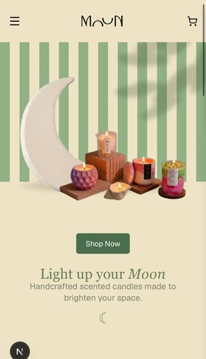
  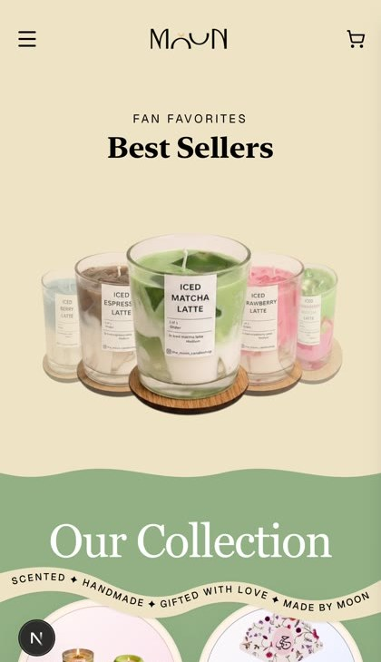
  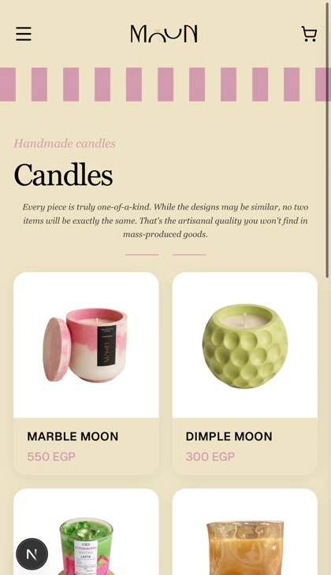
  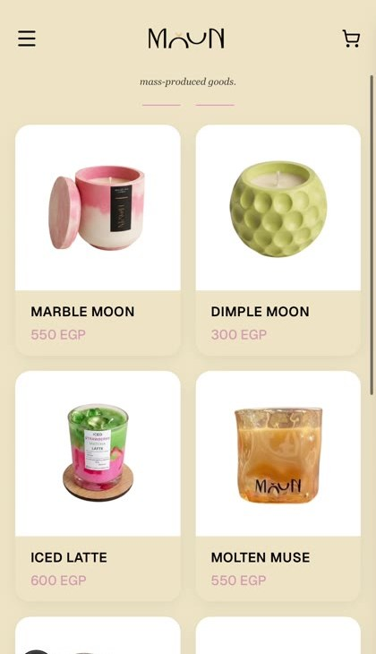
  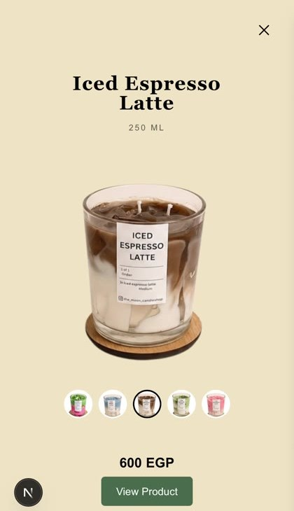
  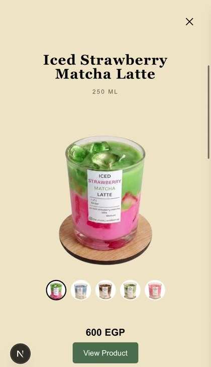
  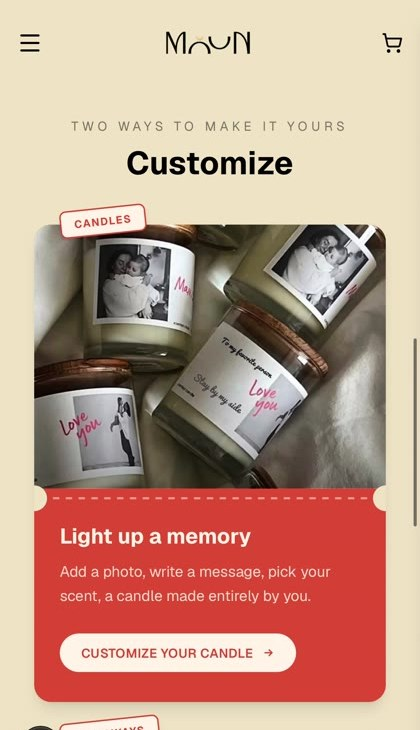
  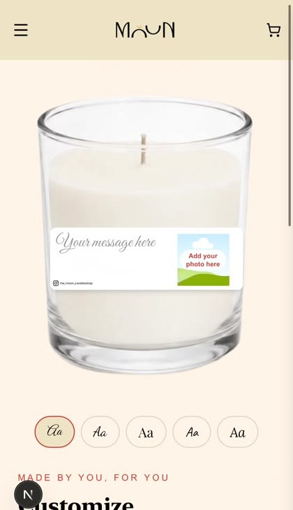
  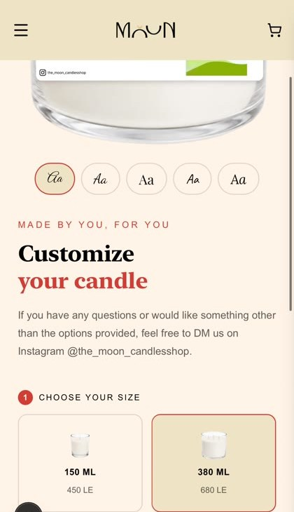
  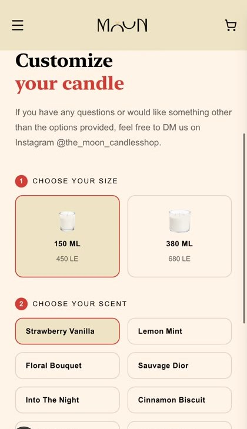
  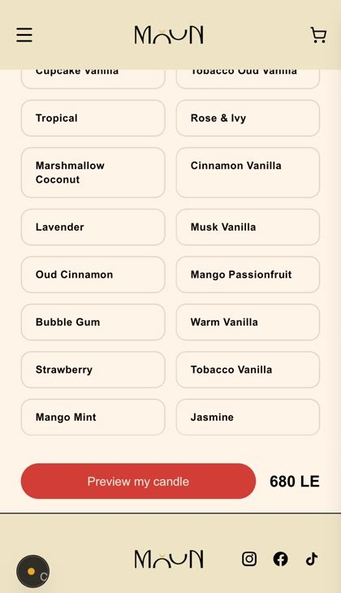
  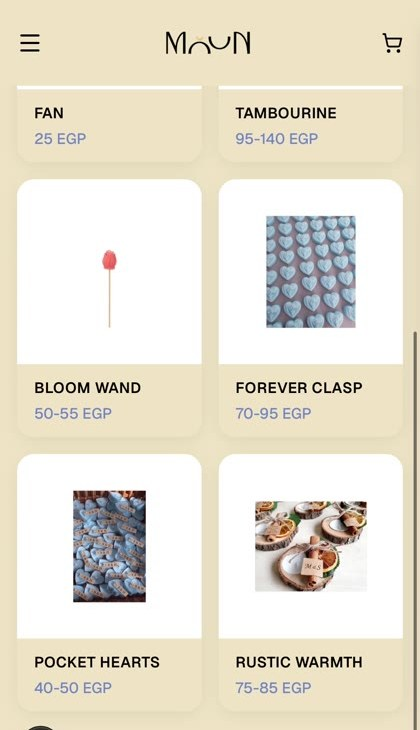
  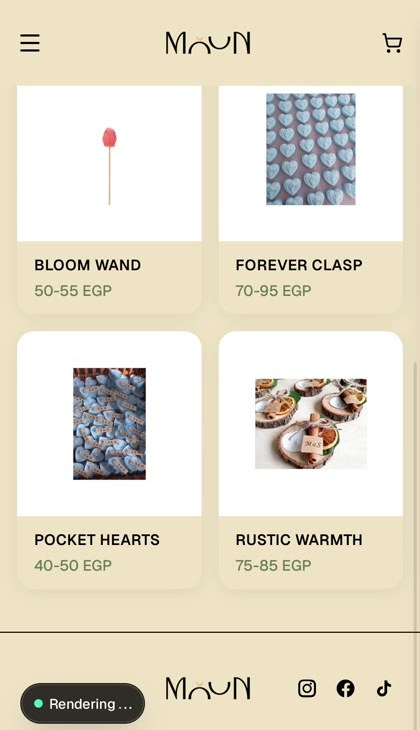
</p>

## Features

**For customers**
- Shop and product pages with variants, scents and prices
- Candle customization with a label editor (Konva) and a live preview
- Builders for a fan, a tambourine and a Bloom Wand, with orders that hold several custom items
- Giveaways page, promo banners and a testimonials section
- Cart drawer and checkout with a delivery form for Egyptian governorates and cash on delivery
- Order confirmation emails (Resend)
- Return policy page
- Animated product visuals

**For the team (admin area)**
- Protected admin area, restricted by email through an `admin_users` table
- Products, scents, discounts and promotions
- Orders, custom orders, customers, reviews, payments and expenses
- Activity log that records which team member changed what, using a shared login with a staff picker
- Recently deleted items (soft delete)
- Export orders and print packing slips
- Admin notifications through web push and Telegram

## Tech stack

| Area | Technology |
| --- | --- |
| Framework | Next.js (App Router), React, TypeScript |
| Styling | Tailwind CSS, framer-motion |
| Database, auth and storage | Supabase (`@supabase/ssr`, `@supabase/supabase-js`) |
| Forms | react-hook-form, zod |
| State | Zustand |
| Label editor | Konva, react-konva, html-to-image |
| Email | Resend |
| Notifications | web-push, Telegram Bot API |
| Hosting | Vercel |

## Project structure

```
src/
  app/
    shop, product, customize (fan, tambourine), customize-mini, bloom-wand,
    giveaways, cart, checkout, return-policy
    admin/            login and the protected admin pages
    api/              admin/log, admin/whoami, send-order-confirmation,
                      push/subscribe, notify-admin
    components/       Header, Footer, ShopGrid, CartDrawer, CandleLabelEditor, ...
  lib/                cart, promotions, packing slips, order export, activity logging,
                      Telegram, image helpers
  lib/supabase/       client, server and generated types
```

## Database

Supabase tables used by the app: `products`, `scent_catalog`, `orders`, `custom_orders`, `promotions`, `promotion_products`, `reviews`, `expenses`, `admin_users`, `admin_staff`, `admin_activity_log`, `admin_seen` and `push_subscriptions`.

Supabase Storage buckets: `product-images` and `customer-uploads`.

> The SQL schema is not included in this repository yet.

## Getting started

**Prerequisites:** a recent LTS version of Node.js and a [Supabase](https://supabase.com) project with the tables and buckets above.

1. Clone the repository and install the dependencies:
   ```bash
   git clone https://github.com/hunia2004-wq/Moon-candles.git
   cd Moon-candles
   npm install
   ```
2. Create a `.env.local` file (see `.env.example` for the full list). Never commit real values.
3. Start the development server:
   ```bash
   npm run dev
   ```
   Open [http://localhost:3000](http://localhost:3000).

Other scripts: `npm run build`, `npm run start` and `npm run lint`.

### Environment variables

| Variable | Used for |
| --- | --- |
| `NEXT_PUBLIC_SUPABASE_URL` | Supabase project URL |
| `NEXT_PUBLIC_SUPABASE_ANON_KEY` | Supabase public key |
| `SUPABASE_SERVICE_ROLE_KEY` | Server-side Supabase access (keep secret) |
| `NEXT_PUBLIC_SITE_URL` | Public site address |
| `RESEND_API_KEY` | Sending order emails |
| `EMAIL_FROM` | Sender address for emails |
| `ADMIN_NOTIFY_EMAILS` | Who receives admin notification emails |
| `NEXT_PUBLIC_VAPID_PUBLIC_KEY`, `VAPID_PRIVATE_KEY`, `VAPID_SUBJECT` | Web push notifications |
| `NOTIFY_WEBHOOK_SECRET` | Protects the notification endpoint |
| `TELEGRAM_BOT_TOKEN`, `TELEGRAM_CHAT_ID` | Telegram admin notifications |

## My contribution

I was the only designer and developer. I met with the owners to understand their vision, designed the look, modeled the database, built the shop and the customization experiences, built the admin area, and kept refining the design after each client meeting.

## Author

**Hunia Khattab**, AI Integration & Full-Stack Developer, Alexandria, Egypt.

[LinkedIn](https://www.linkedin.com/in/hunia-khattab-b831272a7/) · [GitHub](https://github.com/hunia2004-wq) · hunia2004@gmail.com
